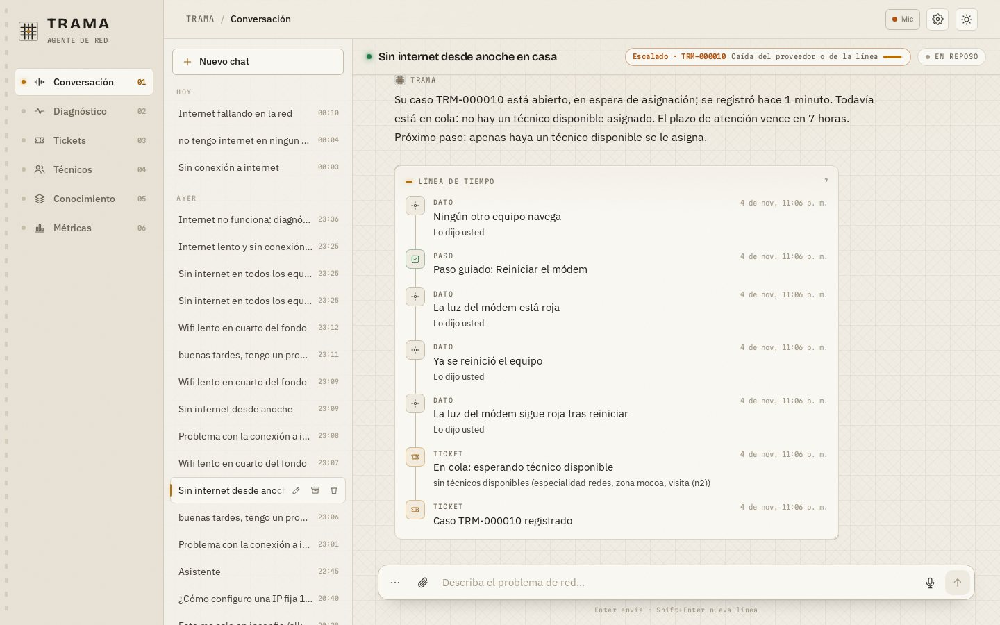
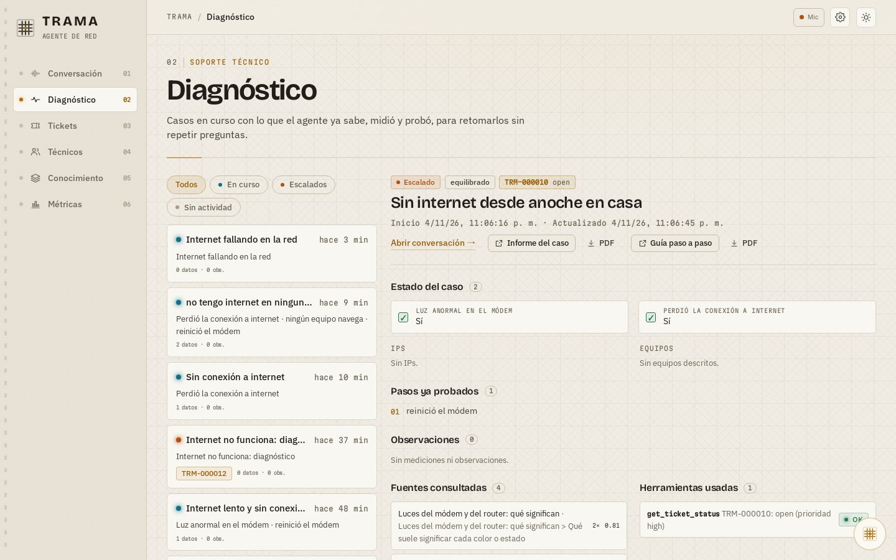
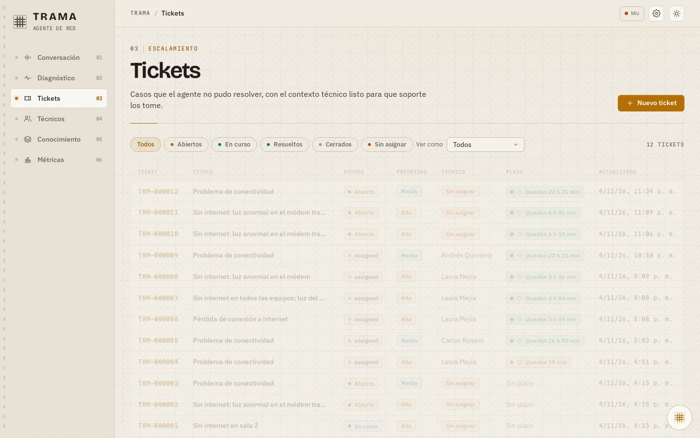
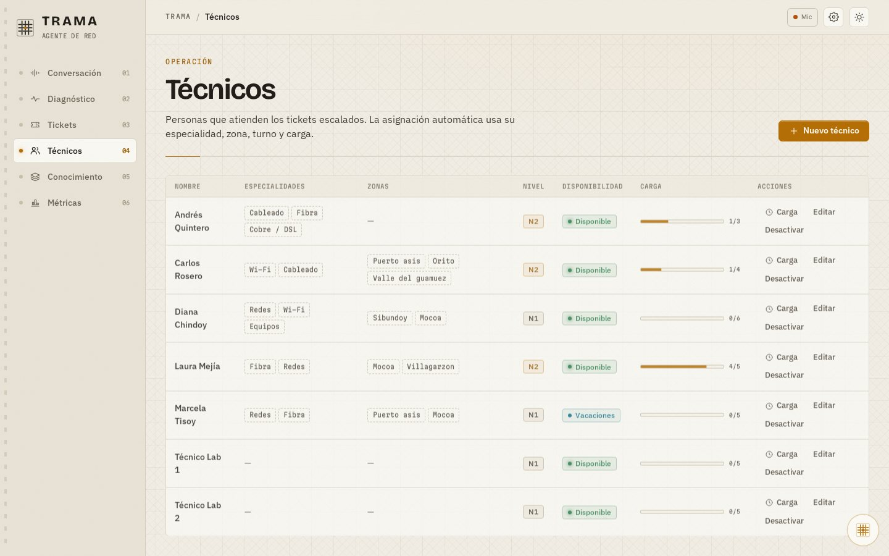
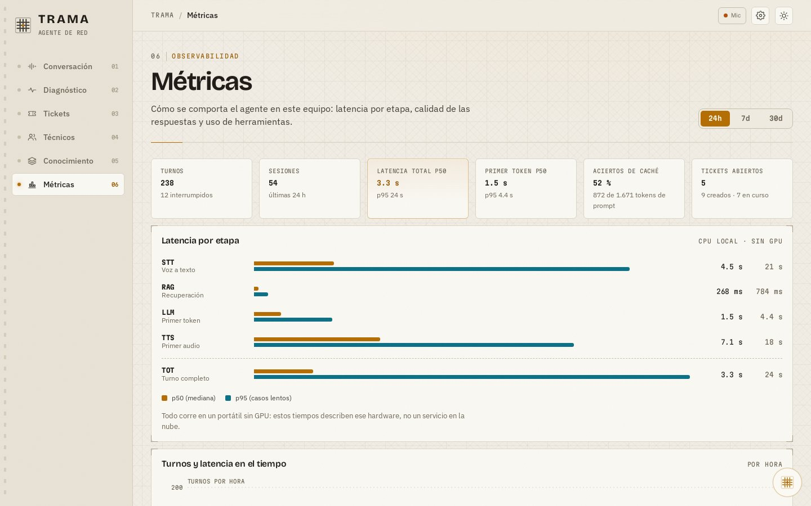
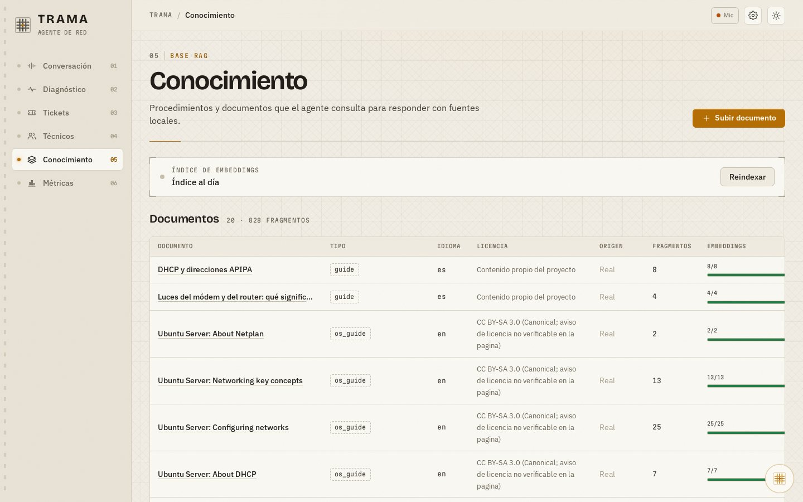
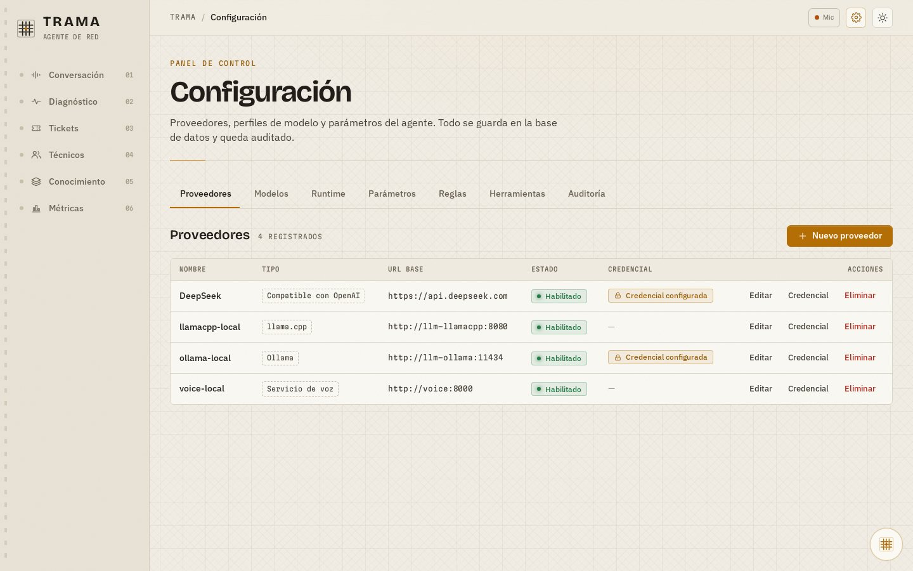
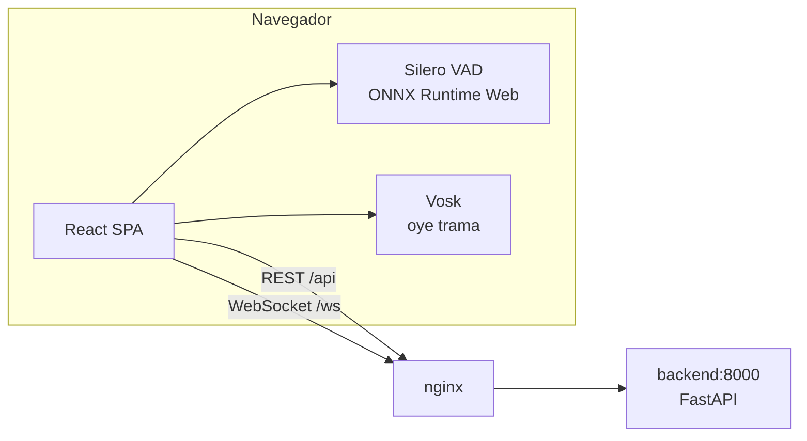

<div align="center">


# TRAMA · Frontend

**Interfaz web de un agente experto que diagnostica fallas de red del hogar, por voz o por texto.**

React 19 · Vite · TypeScript · TanStack Query · xyflow · VAD y wake word en el navegador

[Backend](https://github.com/JhefersonCh/backend-trama) · Taller *Sistemas Expertos* — UniPutumayo

</div>

---



## ¿Qué es TRAMA?

TRAMA no es un chat que responde con lo primero que se le ocurre al modelo. Es un **agente con un objetivo**: encontrar por qué no hay internet. Para eso:

1. **Percibe**: lo que la persona escribe, dice, fotografía o pega (por ejemplo, la salida de `ipconfig`).
2. **Razona**: hechos con factor de certeza, reglas y encadenamiento hacia adelante, como un sistema experto clásico.
3. **Actúa**: pregunta lo que más información aporta, guía pasos con checklists, verifica el resultado y escala con un ticket cuando hace falta.
4. **Explica**: muestra *por qué* llegó a una conclusión, con las reglas que se cumplieron y las fuentes que consultó.

El modelo de lenguaje solo **interpreta y redacta**. Lo que se decide, lo decide el código.

## Lo que hay en la interfaz

| | |
|---|---|
|  |  |
| **Diagnóstico** — cada caso con lo que el agente sabe, los pasos ya probados, las fuentes consultadas y los informes en PDF. | **Tickets** — casos escalados, con plazo (SLA), prioridad y técnico asignado. |
|  |  |
| **Técnicos** — zonas, especialidades y modalidad (remota o visita) para la asignación automática. | **Métricas** — latencias por etapa (STT, LLM, TTS) y rendimiento del agente. |
|  |  |
| **Conocimiento** — documentos que el agente consulta y cita (RAG). | **Configuración** — modelos, proveedores, herramientas y parámetros, todo guardado en la base de datos. |

### Funciones destacadas

- **Modo voz continuo con interrupción.** El navegador detecta cuándo habla la persona (Silero VAD) y, si interrumpe al agente, este se calla.
- **"Oye trama", en cualquier página.** Una palabra de activación local (Vosk, sin enviar audio a nadie) abre un **asistente flotante** que no saca a la persona de lo que está haciendo y sabe en qué pantalla está.
- **Interfaz generativa.** El agente responde con componentes, no solo con texto: respuestas rápidas, checklists, formularios, diagrama de la red, flujo del diagnóstico, barras de hipótesis, línea de tiempo y fotos anotadas.
- **Fotos y capturas.** Se puede enviar una foto del módem o una captura de pantalla. El agente lee las luces o el texto y lo convierte en datos.
- **Bloques de código** con botón de copiar, para comandos y configuraciones.
- **Tema claro y oscuro.**

## Arquitectura



El código está organizado **por funcionalidad** (*screaming architecture*): cada carpeta de `src/features/` es una pantalla o capacidad completa.

```
src/
├── app/            Layout, rutas y estructura general
├── shared/         Cliente de API y WebSocket, kit de UI, íconos
└── features/
    ├── conversation/   Chat, modo voz, palabra de activación
    ├── assistant/      Asistente flotante global
    ├── genui/          Registro cerrado de componentes generativos y diagramas
    ├── diagnostics/    Casos y lo que el agente sabe de cada uno
    ├── tickets/        Tickets y su seguimiento
    ├── technicians/    Técnicos y zonas
    ├── knowledge/      Base de conocimiento (RAG)
    ├── metrics/        Rendimiento del agente
    └── config/         Modelos, proveedores, herramientas y parámetros
```

## Cómo ejecutarlo

> Primero hay que levantar el **backend**: crea la red Docker `trama-net` y expone el servicio `backend:8000` dentro de ella.

```bash
npm run fetch:vosk           # opcional: modelo de "oye trama" (~40 MB, requiere unzip)
docker compose up -d --build
```

Abre **http://localhost:8080**. nginx redirige `/api`, `/health` y `/ws` al backend.

### Desarrollo local

```bash
npm ci
npm run dev                  # http://localhost:5173 (proxy a http://localhost:8000)
npm run test -- --run
npm run build
```

### Recursos de voz (sin CDN)

| Recurso | Cómo se obtiene | Dónde queda |
|---|---|---|
| Silero VAD + ONNX Runtime | se copia automáticamente desde `node_modules` en `dev` y `build` | `public/vad/` |
| Modelo Vosk en español | `npm run fetch:vosk` | `public/vosk/` |

Ninguno de los dos se sube al repositorio. Sin el modelo Vosk, todo lo demás funciona igual; solo queda deshabilitado "oye trama".

El micrófono exige un contexto seguro: `http://localhost` o `https`.

## Decisiones de diseño

- **Nada de credenciales en el frontend ni en `.env`:** los modelos y sus claves se configuran desde la interfaz y viven cifrados en la base de datos.
- **Registro cerrado de componentes:** el agente solo puede mostrar componentes conocidos y validados, nunca HTML arbitrario.
- **Sin CDN:** todos los modelos del navegador se sirven desde el mismo origen; funciona sin internet.
- **Accesible:** cada diagrama tiene una lista equivalente navegable con teclado y lector de pantalla.

---

<div align="center">
<sub>Proyecto académico · Taller de Sistemas Expertos · UniPutumayo</sub>
</div>
